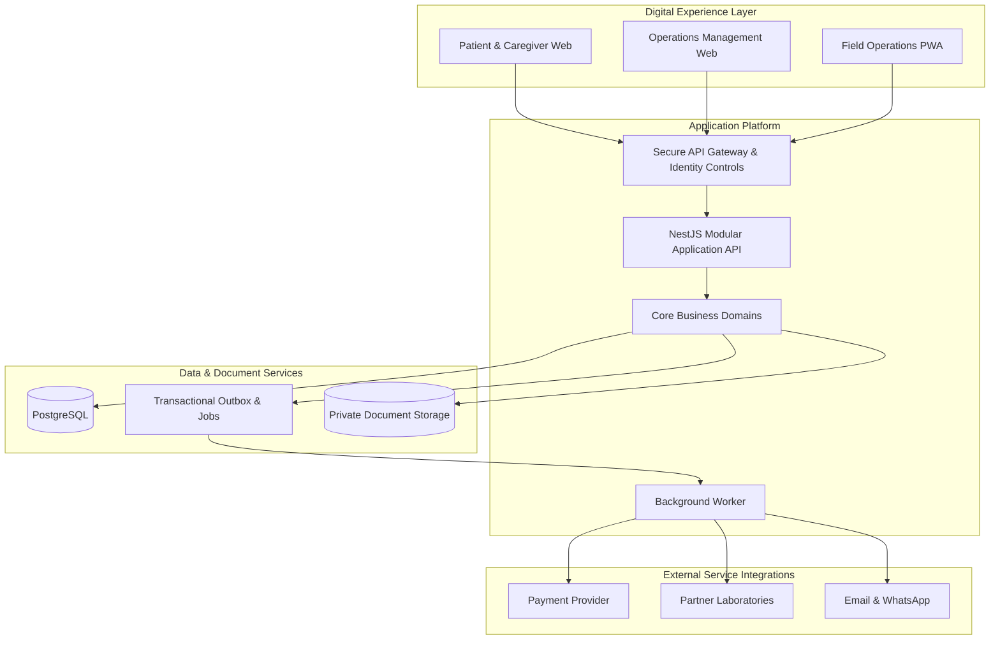

# Technical Architecture and Technology Stack

**Fisher Healthcare | Proposed Platform Architecture**

## 1. Architecture overview

Fisher Healthcare's digital platform is structured as a unified operational system supporting patient bookings, field collection, laboratory coordination, secure results delivery, and financial administration.

The architecture adopts a **TypeScript modular monolith**, supported by distinct web applications and a dedicated background-processing service. This approach establishes clear business-domain ownership while retaining consistent transactional control over patient records, bookings, specimens, and payments.

### Platform architecture



The patient, operations, and field interfaces communicate with the same protected application API. Business rules, identity checks, and resource permissions are enforced centrally. PostgreSQL holds transactional records, while private object storage contains protected result documents. Background processing manages integrations and asynchronous operational work.

## 2. Platform components

### 2.1 Patient and caregiver platform

The customer-facing platform will provide test discovery, coverage and appointment availability, booking for self or authorized relatives, transparent quotations, checkout, order status, patient records, results, and customer support.

### 2.2 Operations management platform

The internal operations platform will support staff and service coverage management, booking administration, dispatch coordination, specimen operations, laboratory partnerships, exception resolution, financial reconciliation, and reporting.

### 2.3 Field operations platform

The mobile-first field application will support assigned collection visits, patient verification, specimen identification, collection checklists, chain-of-custody handoffs, incident documentation, and controlled synchronization of field events.

### 2.4 Application API and business domains

The NestJS API will contain independently organized domain modules for identity, patients and caregivers, catalogue, bookings, scheduling, dispatch, specimens, laboratories, results, payments, communications, and audit. Each domain will expose controlled application interfaces and own its business invariants.

### 2.5 Data and processing services

PostgreSQL will serve as the primary transactional database. A durable job queue and transactional outbox will coordinate reliable asynchronous work. Sensitive result documents will be maintained in private object storage with audited, permission-controlled access.

## 3. Technology stack

| Platform layer | Proposed technology | Intended responsibility |
| --- | --- | --- |
| Programming language | TypeScript (strict mode) | Consistent application and shared contract development |
| Workspace management | pnpm and Turborepo | Monorepo dependency and build orchestration |
| Patient and operations web | Next.js and React | Responsive browser applications |
| Field operations | Next.js progressive web application | Mobile-first collection and transport workflows |
| Design system | Tailwind CSS, shadcn/ui, Radix UI | Accessible reusable interface components |
| Application API | NestJS | Domain services, API validation, and authorization |
| Primary database | PostgreSQL | Transactional and relational data |
| Database access | Drizzle ORM | Typed database access and migrations |
| Authentication | OIDC-compatible identity provider | Identity and session verification |
| Background processing | PostgreSQL-backed jobs and transactional outbox | Reliable tasks and external integration delivery |
| Document storage | Private S3-compatible storage | Secure clinical documents and protected uploads |
| Payments | Paystack integration | Checkout, payment verification, and refunds |
| Customer communications | Transactional email and WhatsApp Business | Customer notifications and service coordination |
| Observability | OpenTelemetry, Sentry, structured logs | Application performance and operational diagnostics |
| Quality assurance | Vitest and Playwright | Automated unit, integration, and end-to-end testing |
| Infrastructure delivery | Docker and GitHub Actions | Environment consistency and controlled software releases |

Provider contracts, infrastructure hosting arrangements, and operational configuration will be finalized as part of the applicable delivery milestones.

## 4. Business domain architecture

| Domain | Core responsibilities |
| --- | --- |
| Identity and Access | Authentication integration, staff roles, patient authorization, and access governance |
| Patients and Caregivers | Patient profiles, relationships, consent, and delegated booking permissions |
| Test Catalogue | Supported tests, preparation instructions, specimen requirements, and laboratory offerings |
| Bookings and Scheduling | Order lifecycle, service tiers, collection windows, and availability |
| Dispatch | Personnel assignment, capacity planning, and visit coordination |
| Specimens | Identification, collection records, custody events, and laboratory handoff |
| Laboratories | Partner configuration, test capability, receipt, and processing coordination |
| Results | Controlled intake, release, dashboard availability, and secure delivery |
| Payments and Finance | Customer payments, refunds, ledger records, and laboratory settlements |
| Communications | Transactional notifications and assisted service communication |
| Governance and Audit | Activity history, exception management, reporting, and operational oversight |

## 5. Repository architecture

The repository is organized around independently maintained applications and shared engineering packages.

```text
apps/
  patient-web/
  operations-web/
  field-pwa/
  api/
  worker/

packages/
  ui/
  design-tokens/
  contracts/
  database/
  auth/
  config/
  testing/
  observability/

infra/
  docker/
  migrations/
  monitoring/

docs/
  adr/
  operations/
  architecture/

scripts/
.github/workflows/
```

The directory map represents the intended repository structure across the development programme. Components are introduced as their associated delivery milestones progress.

## 6. Security and data protection

The platform is designed around centrally enforced access controls, patient-specific data permissions, encrypted transport, private document storage, auditable result access, and separation of clinical and financial responsibilities.

Booking authority and access to diagnostic results remain distinct permissions. Result availability on the patient dashboard and delivery through secure email are governed by the same release and authorization policies.

## 7. Operational reliability

The architecture incorporates transactional consistency, idempotent payment processing, guarded booking transitions, attributable specimen custody, durable background work, retry handling, monitored service health, and auditable operational changes.

Collection and laboratory workflows will retain independent state histories so that an exception affecting one specimen or test does not compromise unrelated services.

## 8. Deployment and environment strategy

Development, staging, and production environments will maintain separate application configuration, secrets, databases, and service integrations. Public interfaces will use HTTPS, while administrative services, databases, and private storage will operate under restricted access.

Production readiness includes automated build and test checks, controlled database migrations, monitoring, backup recovery, security review, and operational approval.

## 9. Platform evolution

The modular architecture supports expansion of laboratory partnerships, service coverage, operational capacity, and partner-facing interfaces without changing the core patient authorization and specimen traceability model.
